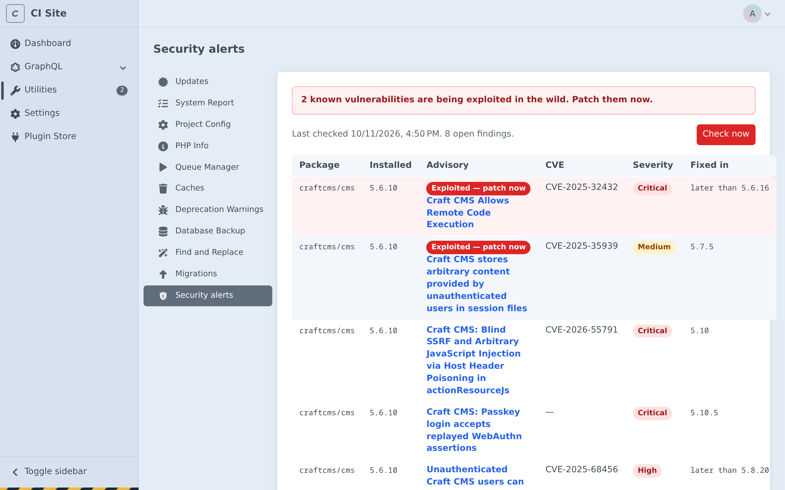
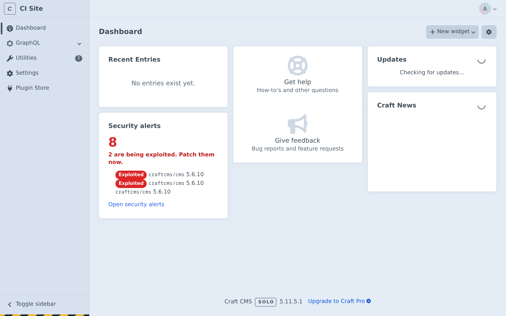
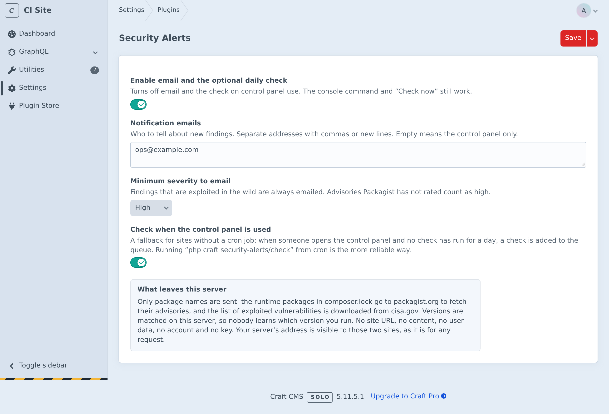

<p align="center">
  <a href="#install"><strong>Install</strong></a> &nbsp;&nbsp;&nbsp;
  <a href="#running-it"><strong>Running it</strong></a> &nbsp;&nbsp;&nbsp;
  <a href="#command-line"><strong>CLI</strong></a> &nbsp;&nbsp;&nbsp;
  <a href="#events"><strong>Events</strong></a> &nbsp;&nbsp;&nbsp;
  <a href="CHANGELOG.md"><strong>Changelog</strong></a>
</p>

<p align="center">
  <a href="https://github.com/Ruvelo/craft-security-alerts/actions/workflows/tests.yml"></a>
  
  
  
  <a href="LICENSE.md"></a>
</p>

# Security Alerts for Craft CMS

**Know before they do.** This plugin tells you, in the control panel and by email, when the exact Craft version you run, or a plugin you installed with Composer, has a known vulnerability. When the flaw is **exploited in the wild**, it says so loudly: "Exploited — patch now".

Craft's own updates screen shows what is new. It does not tell you that the version you are on is being attacked. This plugin is free, MIT licensed, and needs no account and no API key.

```
composer require ruvelo/craft-security-alerts
php craft plugin/install security-alerts
php craft security-alerts/check
```

## A quick tour

> These are screenshots of a real Craft 5.11 install with the plugin (1.0), taken with a `composer.lock` that was deliberately edited to say Craft 5.6.10 so that there is something to show. The advisories are live data, trimmed to eight rows for the picture. Since 1.1 the page also names the data source.



**One page, exploited first.** Utilities → Security alerts lists every finding: the package, the installed version, the advisory (a link), the CVE, the severity, an "Exploited — patch now" badge, and the fixed-in version. "Check now" runs the check straight away, and the page says which data source answered the last check.

<table>
  <tr>
    <td width="50%"></td>
    <td width="50%"></td>
  </tr>
  <tr>
    <td>A dashboard widget with the count, exploited ones highlighted.</td>
    <td>The settings say what leaves the server, right where you switch it on.</td>
  </tr>
</table>

## Features

- **Craft and plugins.** Exact versions come from your project's `composer.lock`: `craftcms/cms`, every plugin and every package they pull in, as long as an advisory is published for it.
- **Exploited in the wild, first.** Findings whose CVE is on the [CISA Known Exploited Vulnerabilities](https://www.cisa.gov/known-exploited-vulnerabilities-catalog) list are labelled "Exploited — patch now", sorted first, and always emailed.
- **Only what is new.** Findings are stored, so you get an email for a new finding, or one that has *become* exploited, and not the same list every morning.
- **A fix version.** The first version that is not affected, followed across release lines (`5.6.x` and `4.14.x`). Some advisories only say "up to 5.6.16"; the plugin then says "later than 5.6.16".
- **Control panel, email, CLI and an event.** A utility, a dashboard widget, an email through Craft's mailer, `php craft security-alerts/check` for CI, and a Craft event for your own tooling.
- **No keys, no account.** Signed answers from Valtry's Advisory API (package names only, never versions), or Packagist and the CISA catalogue directly, which is also the automatic fallback and the opt-out. See [What it sends](#what-it-sends).
- **One engine across platforms.** Reading the lock file, asking the sources, matching versions and working out what changed are done by [`ruvelo/security-advisories`](https://github.com/Ruvelo/security-advisories), the core shared by Ruvelo's security plugins. This plugin is the Craft part: the control panel, email, console command, queue job and the stored findings.
- **Cheap.** A handful of HTTPS requests a day. Nothing runs on a front-end request.

Watching many sites? [Valtry](https://valtry.co.uk/?utm_source=ruvelo&utm_medium=github&utm_campaign=craft-security-alerts) checks every site from the outside, daily.

## What it sends

By default a check asks [Valtry's Advisory API](https://valtry.co.uk/docs/api/advisories), and uses the public feeds whenever Valtry can't answer. Both give the same findings: Valtry serves the same Packagist and CISA data, normalised, in one request.

| Source | Used for | What leaves your server |
|---|---|---|
| Valtry Advisory API (default) | Advisories for your Composer packages, and whether each is exploited (CISA) | **Package names only**, and a random nonce. **Never versions.** |
| [Packagist](https://packagist.org/apidoc#list-security-advisories) (fallback, or `public`) | Advisories | **Package names only** |
| [CISA KEV](https://www.cisa.gov/known-exploited-vulnerabilities-catalog) (fallback, or `public`) | Exploited in the wild | Nothing: the whole catalogue is downloaded |

- **Names only, never versions.** Versions are matched on your server, so nobody learns which version you run. No site URL, no content, no user data, no account, no keys. Valtry doesn't log or store the names it is sent, or pair them with your address; its privacy terms are on [the API page](https://valtry.co.uk/docs/api/advisories). Your server's address is visible to whoever answers, as it is for any request.
- **Signed answers.** Every answer from Valtry carries an Ed25519 signature that is checked against keys built into the plugin (it needs PHP's `sodium` extension, which PHP bundles), together with the random nonce and the list of packages asked about. An answer that fails any check is discarded.
- **Automatic fallback.** If Valtry can't be reached within 5 seconds, answers with an error, sends an answer that doesn't verify, or says its data is out of date, that check uses Packagist and CISA directly instead, and Valtry is left alone for five minutes. The utility page, the console and `--json` say which one answered.
- **Opt out.** Set **Advisory source** to **Public feeds only** in the plugin settings (`advisorySource: public` in project config) and Valtry is never contacted. `RUVELO_ADVISORIES_SOURCE=public` in the server's environment does the same and wins over the setting, so a server's owner can opt out without touching the site's config.

Only runtime packages are sent: `require-dev` packages (`packages-dev` in the lock) are not, and neither are packages on a dev branch such as `dev-main`, which cannot be matched anyway. A private package from a private repository is still sent by name if it is in `packages`, and the sources simply know nothing about it. Requests go through Craft's own HTTP client, so a configured proxy applies. Answers are cached under `storage/runtime/security-alerts` (an hour for advisories, six hours for the CISA catalogue).

The plugin never installs, changes or updates anything, and only writes to its own two tables and that cache.

## Requirements

- Craft CMS 5.x on PHP 8.2 to 8.4.
- A `composer.lock` in the project root (the usual Composer install). Without one, only Craft itself is checked, and "Check now" and the CLI warn you.
- Outbound HTTPS to `valtry.co.uk` (the default source), and to `packagist.org` and `www.cisa.gov` (the fallback, and the only ones used with **Public feeds only**).

## Install

```bash
composer require ruvelo/craft-security-alerts
php craft plugin/install security-alerts
```

Or install it from Settings → Plugins. The install migration creates two tables, `securityalerts_findings` and `securityalerts_state`. Then run the first check:

```bash
php craft security-alerts/check
```

## Running it

Craft has no built-in scheduler, so the daily run is yours to set up. **The recommended way is a cron line** that runs the console command once a day, as the same user that runs your queue:

```cron
17 6 * * * cd /var/www/project && php craft security-alerts/check >/dev/null 2>&1
```

That checks, stores what changed, emails what is new, and fires the event. Nothing else is needed.

**No cron? Use the fallback.** Switch on "Check when the control panel is used" in the plugin settings. When someone opens the control panel and no check has run for a day, the plugin pushes one job onto Craft's queue and the control panel's queue runner executes it. It never runs a check inside the request, queues at most one job an hour while one is waiting, and does nothing for visitors of the front end. It only works on sites whose control panel is visited, and so is a second choice to cron.

"Check now" in the utility always works, whatever the settings.

## Command line

```
php craft security-alerts/check [--json] [--fail-on=exploited|any] [--dry-run]
```

| Option | What it does |
|---|---|
| *(none)* | Check, store what changed, email what is new, and print the findings |
| `--json` | Print the findings as JSON instead of text |
| `--fail-on=exploited` | Exit with code `1` if any finding is known to be exploited |
| `--fail-on=any` | Exit with code `1` if there is any finding |
| `--dry-run` | Only report: no stored changes, no email, no event |

Exit codes: `0` fine, `1` a finding matched `--fail-on`, `2` a source could not be reached or an option is wrong. For a deploy pipeline:

```bash
php craft security-alerts/check --dry-run --json --fail-on=exploited > alerts.json
```

The summary ends with the data source ("… in 111 packages checked via Valtry, signed." or "via public feeds."). JSON shape:

```json
{
  "exploited": 1,
  "total": 1,
  "packages_checked": 111,
  "warnings": [],
  "source": "valtry",
  "sources": { "composer": "valtry" },
  "findings": [
    {
      "package": "craftcms/cms",
      "installed_version": "5.6.10",
      "advisory_id": "PKSA-…",
      "title": "Craft CMS Allows Remote Code Execution",
      "link": "https://github.com/advisories/GHSA-f3gw-9ww9-jmc3",
      "cve": "CVE-2025-32432",
      "severity": "critical",
      "severity_level": "critical",
      "fixed_in": null,
      "fixed_after": "5.6.16",
      "exploited": true
    }
  ]
}
```

`source` is `valtry`, `public` or `mixed`. `severity` is what the source reports, and may be `null`. `severity_level` is what the plugin uses: an unrated advisory counts as **high**, so that a missing rating never hides a real flaw behind the minimum-severity setting.

## Settings

Settings → Plugins → Security Alerts. They are stored in project config, so they deploy with the rest of your configuration. The email field accepts environment variables, such as `$SECURITY_ALERTS_EMAILS`.

| Setting | Default | |
|---|---|---|
| Enable | Yes | Turns off email and the check on control panel use. The console command and "Check now" still work |
| Notification emails | empty | Separate addresses with commas or new lines. Empty means control panel only |
| Minimum severity to email | Medium | Exploited findings are always emailed |
| Advisory source | Valtry | **Valtry (default)** or **Public feeds only**; see [What it sends](#what-it-sends). `RUVELO_ADVISORIES_SOURCE=public` in the environment wins |
| Check when the control panel is used | No | The cron-less fallback described above |

The minimum severity is applied when a finding is first seen: a finding below it is not emailed later if you lower the setting, but it stays in the utility.

You can also set them in `config/project/project.yaml` or with `php craft project-config/set plugins.security-alerts.settings.emails ops@example.com`.

### Permission

Admins can do everything. For others, the plugin adds one permission, **View security alerts and run a check** (`securityAlerts-view`). It is needed to see the page and the widget and to press "Check now". Craft also requires its own Utilities → Security alerts permission to open the utility, so grant both.

## Events

After every check that finds something, the checker triggers `ruvelo\securityalerts\services\Checker::EVENT_FINDINGS_FOUND` with a `ruvelo\securityalerts\events\FindingsEvent`:

| Property | Type | |
|---|---|---|
| `findings` | `Finding[]` | Everything that applies right now, exploited first |
| `newFindings` | `Finding[]` | New since the last check, plus findings that just became exploited |
| `result` | `ScanResult` | Also has `warnings`, `packagesChecked` and `source()` (`valtry`, `public` or `mixed`) |

```php
use ruvelo\securityalerts\events\FindingsEvent;
use ruvelo\securityalerts\services\Checker;
use yii\base\Event;

Event::on(Checker::class, Checker::EVENT_FINDINGS_FOUND, function(FindingsEvent $event) {
    foreach ($event->newFindings as $finding) {
        if ($finding->exploited) {
            // $finding->package, ->installedVersion, ->cve, ->title, ->link, ->fixedIn
        }
    }
});
```

The event is not triggered for `--dry-run`, or when nothing applies.

## FAQ

**Does it send my Craft version, my URL or my content anywhere?**
No. Package names go to Valtry's Advisory API (or to Packagist, with **Public feeds only** or when Valtry can't answer), and versions are matched on your server. See [What it sends](#what-it-sends).

**Does it patch anything?**
No. It tells you what to update.

**Is the list complete?**
No. It knows what the advisory databases behind Packagist list, and which of those CVEs CISA says are exploited. A flaw nobody has published, or that never reached Packagist, is not covered. A CVE reaches the CISA list some time after exploitation starts. It is an early warning, not a scanner: it does not look at your files, your users or your templates.

**A plugin I use is not reported, but I know it has a flaw.**
It has no published advisory, or it is not installed through Composer, or it comes from a private repository that Packagist does not know.

**Why does it say I am affected when I backported a fix?**
Versions are what it can see. A patch applied by hand does not change `composer.lock`.

**Can I run it in CI?**
Yes: `--dry-run --json --fail-on=exploited`.

## Contributing

Pull requests are welcome. Clone, `composer install` (until [`ruvelo/security-advisories`](https://github.com/Ruvelo/security-advisories) is on Packagist, first run `composer config repositories.core vcs https://github.com/Ruvelo/security-advisories`, and don't commit that), then `composer check` runs the code style, PHPStan level 8 and the unit tests, as CI does. You don't need a database for that. CI additionally installs the plugin into a real Craft project. See [CONTRIBUTING.md](CONTRIBUTING.md) and the [changelog](CHANGELOG.md).

## Credits

Built by [François Bultez](https://github.com/francoisbultez) at [Valtry](https://valtry.co.uk/?utm_source=ruvelo&utm_medium=github&utm_campaign=craft-security-alerts), the website security scanner, and everyone who [contributes](https://github.com/Ruvelo/craft-security-alerts/graphs/contributors).

Advisory data comes from [Valtry's Advisory API](https://valtry.co.uk/docs/api/advisories) and the [Packagist security advisories API](https://packagist.org/apidoc#list-security-advisories) (and through it the GitHub Advisory Database and FriendsOfPHP/security-advisories). The list of exploited vulnerabilities is the [CISA KEV catalogue](https://www.cisa.gov/known-exploited-vulnerabilities-catalog). Thanks to everyone who maintains them.

## License

MIT. See [LICENSE.md](LICENSE.md).
